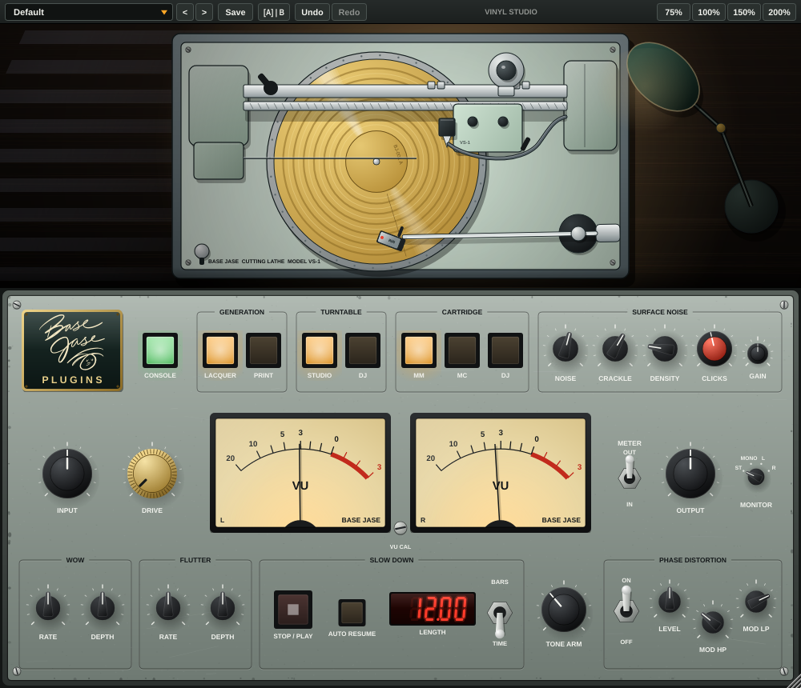

# Vinyl Studio

**Base Jase Plugins.** A vinyl emulation plugin: a vintage mastering console under a
cutting lathe. VST3 and AU on macOS, VST3 on Windows, plus a Standalone app for testing.



Four plugins are built:

| Plugin | Channels | Code | What it is |
| --- | --- | --- | --- |
| Vinyl Studio | stereo | `Bjv1` | full signal chain and lathe scene |
| Vinyl Studio Mono | mono | `Bjv2` | full version, mono in and out |
| Vinyl Studio Lite | stereo | `Bjv3` | noise, crackle, clicks, slow down and metering only |
| Vinyl Studio Lite Mono | mono | `Bjv4` | Lite, mono in and out |

Manufacturer: "Base Jase Plugins" (code `Bjsp`). Bundle IDs: `com.basejaseplugins.vinylstudio[mono|lite|litemono]`.

## Build requirements

- CMake 3.22 or newer, a C++17 compiler, Git (JUCE 8.0.9 is fetched automatically if `./JUCE` is missing)
- macOS: Xcode 14 or newer (builds universal arm64 + x86_64 binaries)
- Windows: Visual Studio 2022 with the C++ workload; Inno Setup 6 on the PATH for the installer (otherwise a zip is made)
- Linux (development builds only): `libasound2-dev libx11-dev libxrandr-dev libxinerama-dev libxcursor-dev libxext-dev libfreetype-dev libfontconfig1-dev libgl1-mesa-dev`

## Build

macOS / Linux:

```bash
./build.sh
```

Windows (x64 Native Tools prompt):

```bat
build.bat
```

Either command configures, builds Release, runs the offline tests and writes
`dist/BaseJasePlugins-VinylStudio-<version>/` plus a zip of it. On macOS that folder
holds `BaseJasePlugins-VinylStudio-<version>.pkg`; on Windows the Inno Setup installer.

Every build also installs the plugins for the current user (`COPY_PLUGIN_AFTER_BUILD`):

- macOS: `~/Library/Audio/Plug-Ins/VST3/` and `~/Library/Audio/Plug-Ins/Components/`
- Windows: `C:\Program Files\Common Files\VST3\` (needs an elevated prompt)

Set `NO_INSTALL=1` to skip that copy, `SKIP_TESTS=1` to skip the tests.

### Signing and notarization (macOS)

Without credentials the plugins are ad-hoc signed. For a distributable installer:

```bash
DEVELOPER_ID_APP="Developer ID Application: Your Name (TEAMID)" DEVELOPER_ID_INSTALLER="Developer ID Installer: Your Name (TEAMID)" NOTARY_PROFILE=my-profile ./build.sh
```

`NOTARY_PROFILE` is a keychain profile created once with `xcrun notarytool store-credentials`.

## Manual install

| File | Goes in |
| --- | --- |
| `Vinyl Studio*.vst3` (macOS) | `/Library/Audio/Plug-Ins/VST3/` or `~/Library/Audio/Plug-Ins/VST3/` |
| `Vinyl Studio*.component` (macOS, AU) | `/Library/Audio/Plug-Ins/Components/` or `~/Library/Audio/Plug-Ins/Components/` |
| `Vinyl Studio*.vst3` (Windows) | `C:\Program Files\Common Files\VST3\` |

Copy the whole `.vst3` / `.component` bundle (it is a folder). Some DAWs need a plugin
rescan before new plugins appear; Logic may need a restart so the AU is validated.

User presets live in:

- macOS: `~/Library/Audio/Presets/Base Jase Plugins/Vinyl Studio/`
- Windows: `Documents\Base Jase Plugins\Vinyl Studio\Presets\`

## Testing

- `vs_tests` (built with the plugins, run by the build script): CPU load of all four
  variants at 44.1 to 192 kHz, click-free tone-arm automation and slow down, state
  save/restore, noise level of the 12 setups, GUI render cost and screenshots at
  75/100/150/200 %.
- macOS: `build.sh` runs `auval -v aufx Bjv1..4 Bjsp` and, if pluginval is installed,
  pluginval at strictness 10 on every VST3 and AU.

## Layout

| Path | Contents |
| --- | --- |
| `Source/dsp` | noise engine (C++ port of Stage 1), record chain, slow down, filters |
| `Source/gui` | vector look-and-feel, controls, lathe scene, editor |
| `Assets` | embedded sample library and logo (generated by `tools/export_library.py`) |
| `stage1` | the Python crackle-engine prototype and analysis |
| `installer` | macOS `.pkg` resources, Inno Setup script |
| `docs/UserGuide.md` | user guide |
