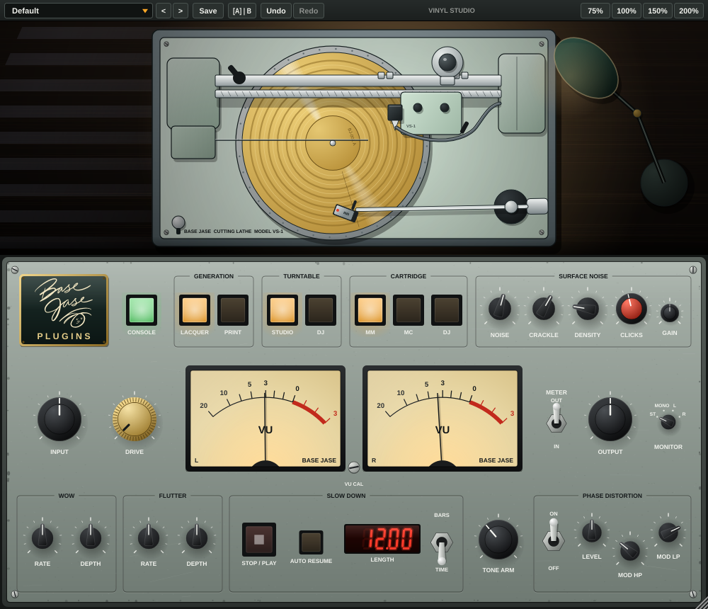
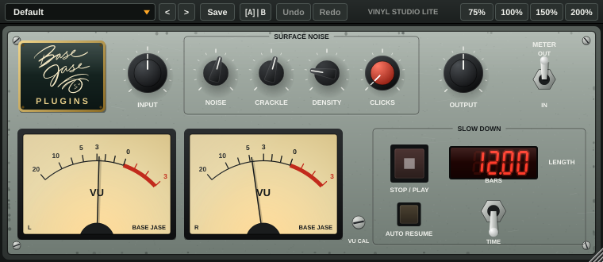

# Vinyl Studio user guide

**Base Jase Plugins**

Vinyl Studio puts your audio through the life of a record: mastering console, cutting
lathe, the disc itself, a turntable and cartridge, and the phono stage. The top of the
window shows the lathe; the bottom is the console that holds every control.

Every control can be automated. Double-click a control to reset it. Hold Shift or
Cmd/Ctrl while dragging for fine adjustment. Hover for the exact value; while you drag a
knob its label shows the value.

## Top bar

| Control | What it does |
| --- | --- |
| Preset menu, `<` `>` | Factory presets (Pristine Lacquer, Worn Pressing, DJ Battle Record, End of Side, Dusty Sample, Lo-Fi Bed, Tape Stop Spin-Down) and your own |
| Save | Type a name and press Enter to save a user preset |
| A / B | Switch between two sets of settings to compare them |
| Undo / Redo | Step back and forward through your changes |
| 75% 100% 150% 200% | Window size. You can also drag the bottom-right corner. The size is saved with the session |

## The lathe scene

- The record turns at 33⅓ rpm and follows Slow Down: it brakes, stops and spins up with the sound.
- The playback arm follows **Tone Arm**; its cartridge changes with the **Cartridge** buttons.
- **Lacquer** shows a glossy gold acetate, **Print** a black pressed record with a label. The **DJ** turntable adds a pitch fader and denser strobe marks.
- **Click the left side of the record** to stop or start it.

## Console, top row

| Control | Range (default) | What it does |
| --- | --- | --- |
| Badge | | Opens the About screen |
| Console | On / Off (On) | The mastering console: its own EQ curve, gentle harmonic distortion and noise floor |
| Generation | Lacquer / Print (Lacquer) | Lacquer is the clean first cut. Print is a pressing: more noise and crackle, slightly less top end, some colour |
| Turntable | Studio / DJ (Studio) | Studio is pristine with low rumble and very little wow. DJ is a direct drive: more rumble and wow, much faster start |
| Cartridge | MM / MC / DJ (MM) | MM is flat with good transients. MC has extended highs and lows and the lowest noise. DJ is mid-forward and gritty |
| Noise | -inf to +48 dB (0) | Continuous surface hiss, and the turntable rumble with it |
| Crackle | -inf to +48 dB (0) | Fine granular groove crackle |
| Density | Off to 100 (20) | How often clicks happen: about one every 5 to 10 seconds at the low end, about two per second at 100 |
| Clicks (red) | Off to 100 (Off) | Level of the larger clicks and pops. Double-click sets 50 |
| Gain | -24 to +24 dB (0) | Extra level trim for the clicks |

The noise, crackle and clicks change character with every Generation, Turntable and
Cartridge combination (12 in all). Crackle ducks very slightly under loud music.

## Console, middle row

| Control | Range (default) | What it does |
| --- | --- | --- |
| Input | -18 to +18 dB (0) | Level into the chain |
| Drive (gold) | 0 to 100 (0) | Pushes the level into the console and cutter and takes the same amount off at the output: more distortion, about the same loudness |
| VU meters | | Left and right, with real VU ballistics (300 ms) |
| VU Cal (screw) | 8 to 24 dB (18) | Headroom: 0 VU equals a sine at minus this many dBFS |
| Meter | In / Out (Out) | What the meters show |
| Output | -18 to +18 dB (0) | Final level |
| Monitor | Stereo / Mono / L / R (Stereo) | What you hear |

## Console, bottom row

| Control | Range (default) | What it does |
| --- | --- | --- |
| Wow Rate | Off to 100 (50) | Speed of the slow pitch drift. 50 is once per revolution |
| Wow Depth | -50 to +50 (0) | 0 is the natural amount for the chosen setup. Lower reduces it, higher exaggerates it |
| Flutter Rate | Off to 100 (50) | Speed of the faster level wobble |
| Flutter Depth | -50 to +50 (0) | As Wow Depth, for flutter |
| Stop / Play | | Slows the record to a stop. It stays stopped until you press again |
| Auto Resume | On / Off (Off) | Start again automatically once the record has stopped |
| Length (red display) | 1 ms to 30 s (12 s), or 1 beat to 8 bars | How long the slow-down takes. Drag the display to change it |
| Time / Bars | (Time) | Length in seconds, or in beats and bars of the host tempo (follows tempo changes; bars are counted as 4 beats) |
| Tone Arm | 0 to 100 (0) | Position across the side. 0 is the start of the record, 100 the end groove. Further in means less top end and more inner-groove distortion. Smooth enough to automate across a whole song |
| Phase Distortion | On / Off (On) | Tracing distortion: a copy of the signal is modulated and mixed back |
| Level | -48 to +48 dB (0) | Amount of phase distortion |
| Mod HP / Mod LP | 16 Hz to 20 kHz | Which frequencies drive the modulation |

Wow Rate, Flutter Rate, phase distortion Level and the Mod filters jump to new defaults
when you change Generation, Turntable or Cartridge.

## Lite versions

Vinyl Studio Lite keeps Input, Output, Noise, Crackle, Density, Clicks, Slow Down and
the meters, and leaves your audio otherwise untouched. It uses a small fraction of the
CPU and adds no latency.

## Good to know

- The full version reports its latency to the host (about 17 ms) so tracks stay aligned.
- Presets are stored in `~/Library/Audio/Presets/Base Jase Plugins/Vinyl Studio/` (macOS) or `Documents\Base Jase Plugins\Vinyl Studio\Presets\` (Windows).
- If the plugin does not show up after installing, rescan plugins in your DAW.
